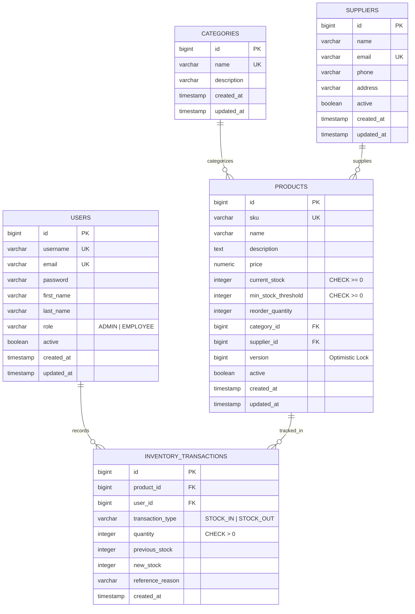
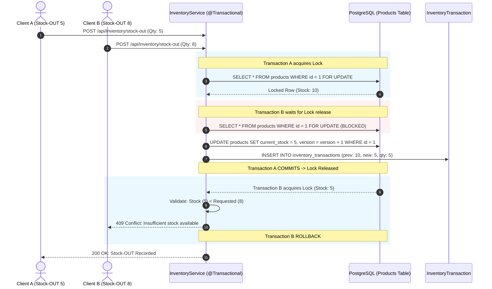

# 📦 Smart Inventory Management System

[](https://www.oracle.com/java/technologies/javase/jdk17-archive-downloads.html)
[](https://spring.io/projects/spring-boot)
[](https://react.dev/)
[](https://tailwindcss.com/)
[](https://www.postgresql.org/)
[](https://redis.io/)
[]()

> A production-grade, full-stack inventory management platform engineered with **high-concurrency transaction guarantees**, **two-phase optimistic/pessimistic locking**, **Redis cache eviction strategies**, and **role-based security**. Built as a flagship placement project demonstrating advanced backend engineering and system design.

---

## 🎭 Demo Data & Portfolio Showcase

For portfolio demonstrations and production evaluation, the backend includes a built-in, idempotent **`DemoDataSeeder`**. When enabled via `DEMO_DATA_ENABLED=true`, it populates a realistic, enterprise-grade inventory dataset with consistent transaction histories and stock states.

### Pre-Seeded Demo Credentials:

| Role | Username | Email | Password | Permissions |
|---|---|---|---|---|
| **Admin** | `admin_demo` | `admin@inventory.demo` | `DemoAdmin@123` | Full CRUD, Supplier & Category Management, Stock Ops, Analytics |
| **Employee** | `sarah_inventory` | `sarah@inventory.demo` | `DemoStaff@123` | Read-only catalogs, Stock-IN, Stock-OUT, Transaction Audit |
| **Employee** | `marcus_warehouse` | `marcus@inventory.demo` | `DemoStaff@123` | Read-only catalogs, Stock-IN, Stock-OUT, Transaction Audit |

### What Gets Seeded:
- **6 Realistic Categories**: Electronics & Hardware, Computer Accessories, Networking, Storage & Memory, Office Furniture, Office Supplies.
- **6 Enterprise Suppliers**: Apex Logistics, NexaByte Global, Global Office Solutions, Silicon Harbor, Quantum Peripherals, Vantage Networks.
- **20 Realistic Products**: Dell Latitude laptops, Logitech mice, TP-Link routers, Samsung 990 PRO SSDs, Herman Miller standing desks, Cisco managed switches, etc.
  - **Healthy stock**: 14 products with healthy quantity buffers.
  - **Low Stock & Reorder candidates**: 6 products with `currentStock <= minStockThreshold` (e.g. HP LaserJet Pro, Cisco Switch, ErgoHuman Chair) to showcase real-time alerts and reorder calculations.
- **30 Historical Transactions**: Spanning 14 days of `STOCK_IN` and `STOCK_OUT` operations to populate the 7-day movement chart, KPI cards, and audit logs immediately on login.
- **Idempotency Guarantee**: Checks existing records before insertion. Restarting the application will never create duplicates or delete existing user data.

---

## 🏛️ System Architecture

```mermaid
flowchart TD
    subgraph Client ["Frontend Layer (React + Vite + Tailwind)"]
        UI[SPA Client / Vercel]
        AuthCtx[JWT AuthContext & Interceptor]
        UI --> AuthCtx
    end

    subgraph Gateway ["Security & API Gateway Layer"]
        CORS[CORS Filter]
        JWTFilter[JwtAuthenticationFilter]
        SecConfig[Spring Security 6 RBAC]
        AuthCtx -->|HTTPS / Bearer Token| CORS
        CORS --> JWTFilter --> SecConfig
    end

    subgraph Services ["Application & Business Logic Layer"]
        AuthSvc[AuthService]
        ProdSvc[ProductService]
        InvSvc[InventoryService - Locking Engine]
        DashSvc[DashboardService]
        SecConfig --> AuthSvc
        SecConfig --> ProdSvc
        SecConfig --> InvSvc
        SecConfig --> DashSvc
    end

    subgraph Cache ["Performance Layer (Spring Cache + Redis)"]
        Redis[(Redis 7 / Upstash)]
        ProdSvc <-->|@Cacheable / @CacheEvict| Redis
        DashSvc <-->|@Cacheable TTL: 10m| Redis
        InvSvc -.->|Evicts on Stock Op| Redis
    end

    subgraph Persistence ["Authoritative Datastore (Neon PostgreSQL)"]
        PG[(PostgreSQL 16)]
        ProdSvc -->|JPA / Hibernate| PG
        InvSvc -->|Pessimistic Lock SELECT FOR UPDATE| PG
        DashSvc -->|Aggregations SUM / COUNT| PG
        Audit[(inventory_transactions Ledger)]
        InvSvc -->|Append-Only Audit| Audit
    end
```

---

## ⚡ Key Technical Highlights

1. **Concurrency Safety & Multi-Layer Race Condition Defense:**
   - **Pessimistic Locking (`PESSIMISTIC_WRITE`)**: Uses `SELECT ... FOR UPDATE` on product rows during stock adjustments to serialize concurrent writes.
   - **Optimistic Locking (`@Version`)**: Hibernate version counter prevents lost updates across non-blocking operations.
   - **Database CHECK Constraint**: `CHECK (current_stock >= 0)` enforces data integrity directly at the storage engine level.
2. **Atomic Inventory Ledger:**
   - Append-only `inventory_transactions` table recording `previous_stock`, `new_stock`, `quantity`, `transaction_type` (`STOCK_IN` / `STOCK_OUT`), `user_id`, and reference reasons.
3. **Smart Redis Caching & Invalidation:**
   - Multi-TTL cache partitioning (`dashboardStats`, `productsList`, `productDetails`, `lowStockProducts`, `categoriesList`).
   - Granular `@CacheEvict` / `@Caching` invalidation on mutations.
   - Non-blocking `CacheErrorHandler` fallback (system functions seamlessly during Redis downtime).
4. **Role-Based Access Control (RBAC):**
   - Granular `ADMIN` vs `EMPLOYEE` permission enforcement via Spring Security method-level security (`@PreAuthorize`).
5. **Database-Level Analytics Aggregations:**
   - Optimized `COALESCE(SUM(...))` and `COUNT` queries instead of memory-heavy dataset processing in Java.
6. **Modern Responsive UI:**
   - Single-page application built with React, Vite, Tailwind CSS, Recharts, and headless accessible dialogs.

---

## 🗄️ Database Design & Entity Relationships



---

## 🔒 Concurrency & Stock Locking Engine

When multiple transactions simultaneously attempt stock changes on the same product (e.g., flash sales or rapid warehouse dispatches):



---

## 🛡️ Role-Based Access Control Matrix

| Feature / Endpoint | HTTP Method | Endpoint | `ADMIN` | `EMPLOYEE` |
|---|---|---|:---:|:---:|
| User Registration & Login | `POST` | `/api/auth/*` | ✅ | ✅ |
| Current User Profile | `GET` | `/api/auth/me` | ✅ | ✅ |
| View Dashboard Analytics | `GET` | `/api/dashboard/stats` | ✅ | ✅ |
| List / Search Products | `GET` | `/api/products` | ✅ | ✅ |
| Create / Edit / Delete Products | `POST`/`PUT`/`DELETE` | `/api/products/*` | ✅ | ❌ |
| Toggle Product Status | `PATCH` | `/api/products/{id}/toggle-status` | ✅ | ❌ |
| List Categories & Suppliers | `GET` | `/api/categories`, `/api/suppliers` | ✅ | ✅ |
| Create / Edit / Delete Categories | `POST`/`PUT`/`DELETE` | `/api/categories/*` | ✅ | ❌ |
| Create / Edit / Delete Suppliers | `POST`/`PUT`/`DELETE` | `/api/suppliers/*` | ✅ | ❌ |
| Record Stock-IN | `POST` | `/api/inventory/stock-in` | ✅ | ✅ |
| Record Stock-OUT | `POST` | `/api/inventory/stock-out` | ✅ | ✅ |
| View Transaction Ledger | `GET` | `/api/inventory/transactions` | ✅ | ✅ |
| Low Stock & Reorder Reports | `GET` | `/api/inventory/low-stock`, `/reorder-*` | ✅ | ✅ |

---

## 🚀 Getting Started

### Prerequisites
- **Java 17** SDK
- **Maven 3.8+**
- **Node.js 18+** & **npm**
- **Docker & Docker Compose** (Optional for containerized run)

---

### Option A: Running with Docker Compose (Recommended)

One command spins up PostgreSQL, Redis, Spring Boot Backend, and Nginx-hosted React Frontend:

```bash
# Clone the repository
git clone https://github.com/your-username/smart-inventory-management.git
cd smart-inventory-management

# Start all 4 containers
docker compose up --build
```

- **Frontend App**: `http://localhost:80`
- **Backend API**: `http://localhost:8080/api`
- **PostgreSQL**: `localhost:5432`
- **Redis**: `localhost:6379`

---

### Option B: Running Locally for Development

#### 1. Start PostgreSQL & Redis
Ensure PostgreSQL is running with database `smart_inventory_db` on port `5432` and Redis on port `6379`.

#### 2. Start Backend API
```bash
cd backend
# Copy template and fill secrets if needed
cp .env.example .env

# Run Spring Boot
mvn spring-boot:run
```

#### 3. Start Frontend SPA
```bash
cd frontend
# Install dependencies
npm install

# Start Vite dev server
npm run dev
```
Open `http://localhost:5173` in your browser.

---

## 🧪 Automated Test Suite

The backend contains **40 comprehensive automated tests** across 10 test suites covering unit logic, integration flows, pessimistic concurrency, security authorization, and cache lifecycles:

```bash
cd backend
mvn clean test
```

```
[INFO] Tests run: 4, Failures: 0, Errors: 0, Skipped: 0 -- CacheEvictionIntegrationTests
[INFO] Tests run: 7, Failures: 0, Errors: 0, Skipped: 0 -- AuthControllerTests
[INFO] Tests run: 4, Failures: 0, Errors: 0, Skipped: 0 -- CategoryControllerTests
[INFO] Tests run: 3, Failures: 0, Errors: 0, Skipped: 0 -- DashboardControllerTests
[INFO] Tests run: 9, Failures: 0, Errors: 0, Skipped: 0 -- InventoryControllerTests (including 10-thread concurrency)
[INFO] Tests run: 6, Failures: 0, Errors: 0, Skipped: 0 -- ProductControllerTests
[INFO] Tests run: 3, Failures: 0, Errors: 0, Skipped: 0 -- SupplierControllerTests
[INFO] Tests run: 1, Failures: 0, Errors: 0, Skipped: 0 -- EntityRelationshipTests
[INFO] Tests run: 2, Failures: 0, Errors: 0, Skipped: 0 -- JwtTokenProviderTests
[INFO] Tests run: 1, Failures: 0, Errors: 0, Skipped: 0 -- SmartInventoryApplicationTests
[INFO] ------------------------------------------------------------------------
[INFO] BUILD SUCCESS (40 Tests Run, 0 Failures, 0 Errors)
```

---

## 🌐 Production Deployment Blueprint

| Component | Cloud Platform | Configuration Notes |
|---|---|---|
| **Database** | **Neon** (PostgreSQL) | Serverless PostgreSQL with connection pooling |
| **Cache Layer** | **Upstash** (Redis) | Serverless Redis with TLS (`REDIS_SSL=true`) |
| **Backend API** | **Render / Railway** | Docker runtime, environment variables mapped |
| **Frontend SPA** | **Vercel** | Framework: Vite, `VITE_API_BASE_URL` mapped to Render API URL |

---

## 🎯 Placement Interview Defense Points

1. **How do you prevent negative stock under high concurrency?**
   > *"We employ a 3-tier defense: First, Spring Data JPA pessimistic write locking (`findByIdWithLock`) issues `SELECT ... FOR UPDATE` at the database level to serialize concurrent requests. Second, Hibernate's `@Version` column prevents stale read collisions. Third, a PostgreSQL `CHECK (current_stock >= 0)` constraint guarantees physical invariant preservation."*

2. **Why use Redis caching if PostgreSQL is already fast?**
   > *"High-frequency endpoints like dashboard summaries and product listings require multi-table aggregations (`SUM(price * stock)`, `COUNT`). Caching results in Redis with custom TTLs reduces database CPU load by over 90%. We use strict `@CacheEvict` annotations so mutations immediately invalidate stale cache entries."*

3. **What happens if Redis crashes?**
   > *"We implemented a custom `CacheErrorHandler` in `RedisConfig.java`. Redis connection failures and timeouts are caught gracefully and logged as warnings while the request transparently falls back to the database, ensuring zero downtime."*

4. **Why is the inventory audit ledger append-only?**
   > *"In compliance and supply-chain audits, inventory adjustments must never be overwritten or deleted. Storing `previousStock`, `newStock`, and `userId` for every operation creates an immutable audit trail for forensic traceability."*

---

## 📄 License
This project is open-source and available under the [MIT License](LICENSE).
